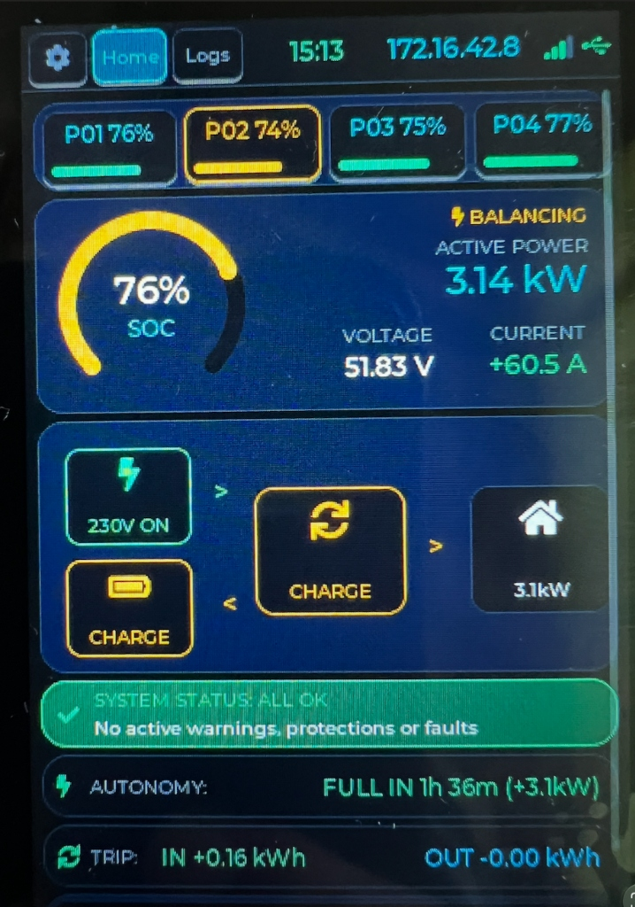
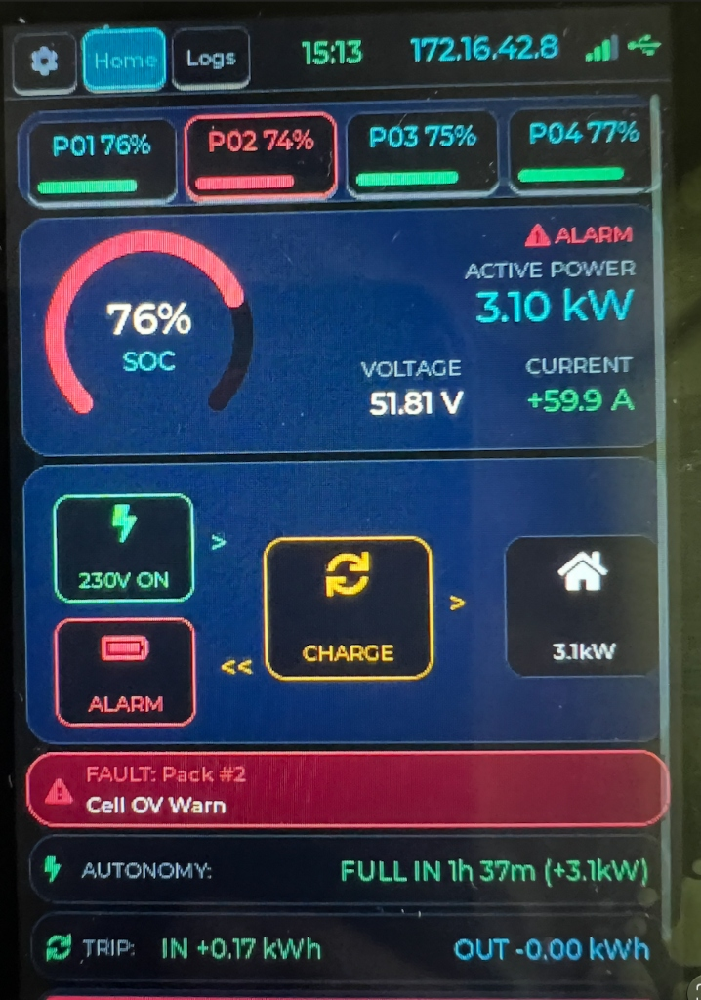
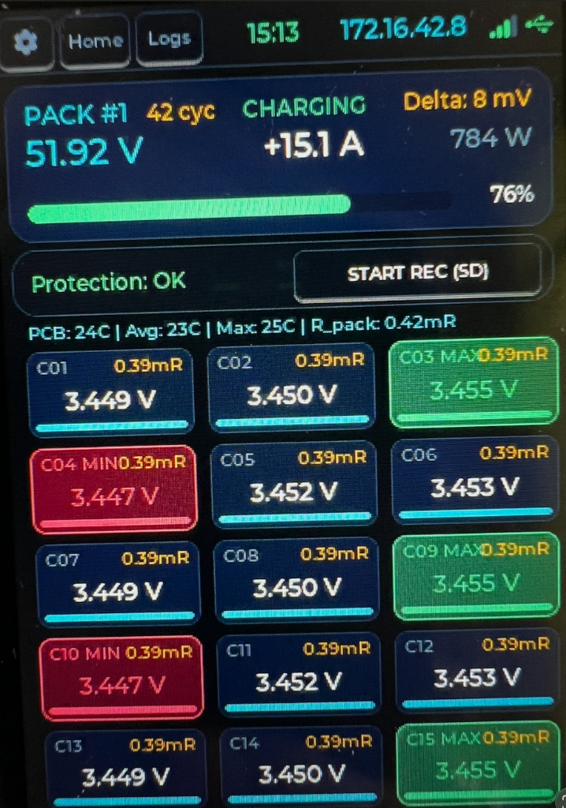
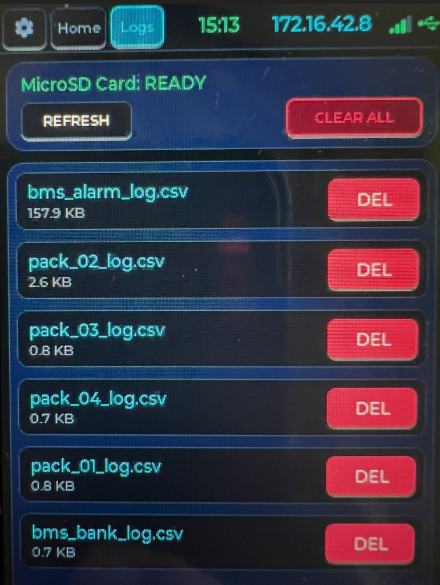
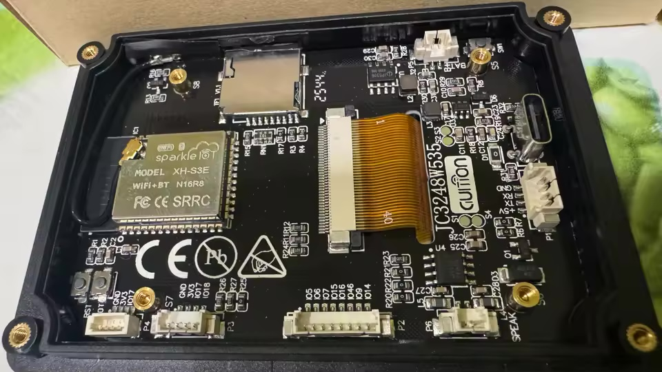
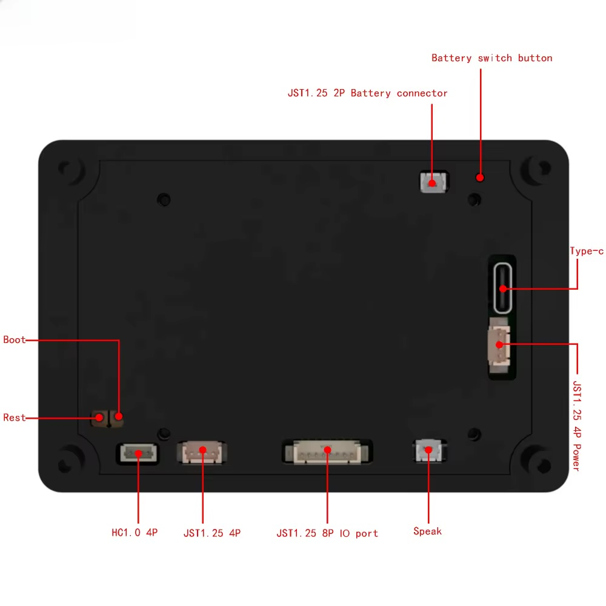

# 🔋 Vision BMS Multi-Pack Monitor & Diagnostics (JC3248W535 / JC3248W535C)

Повноцінний автономний апаратно-програмний комплекс моніторингу, діагностики та захисту акумуляторних батарей **Vision V-LFP48100 15S LiFePO4** (до 16 АКБ) на базі сенсорного смарт-дисплея **Guition JC3248W535 / JC3248W535C** (ESP32-S3, 3.5" IPS 320x480, QSPI AXS15231B, Touch I2C, MicroSD, I2S Audio, Wi-Fi Web Gateway).

---

## 📖 Зміст
1. [Принцип роботи та безпека (Passive RS485 Sniffer)](#1-принцип-роботи-та-безпека)
2. [Швидкий старт (Що робити, тримаючи екранчик в руках)](#2-швидкий-старт)
3. [Інтерфейс на екрані пристрою (LVGL UI v2.0 Ultra)](#3-інтерфейс-на-екрані-пристрою)
   - [Верхня панель навігації та статусу](#верхня-панель-навігації-та-статусу)
   - [Вкладка «Settings» (Налаштування яскравості, сну та заставки)](#вкладка-settings-налаштування)
   - [Вкладка «Home» (Головний екран та жива енергетична схема)](#вкладка-home-головний-екран)
   - [Вкладки окремих АКБ «P1», «P2», «P3»... (Модулі комірок)](#вкладки-окремих-акб-p1-p2-p3-p4)
   - [Вкладка «Logs» (Файловий менеджер MicroSD)](#вкладка-logs-керування-micro-sd-карткою)
   - [Хаотичний скрінсейвер (Clock Screensaver з захистом матриці)](#хаотичний-скрінсейвер-clock-screensaver)
4. [Веб-інтерфейс моніторингу (Wi-Fi Dashboard)](#4-веб-інтерфейс-моніторингу-wi-fi-dashboard)
   - [Підключення до Wi-Fi (Captive Portal)](#підключення-до-wi-fi-captive-portal)
   - [Вкладка «Загальний огляд»](#вкладка-загальний-огляд)
   - [Вкладка «Графіки та Діагностика»](#вкладка-графіки-та-діагностика)
   - [Вкладка «Аналіз логу» (Offline CSV Viewer)](#вкладка-аналіз-логу-offline-csv-viewer)
5. [Логування даних та робота з MicroSD](#5-логування-даних-та-робота-з-microsd)
   - [Автоматичний аварійний запис (Auto Alarm REC)](#автоматичний-аварійний-запис-auto-alarm-rec)
   - [Ручний запис у приладі (MicroSD)](#ручний-запис-у-приладі-microsd)
   - [Запис логів на комп'ютер у браузері](#запис-логів-на-компютер-у-браузері)
6. [Звукова індикація та енергозбереження](#6-звукова-індикація-та-енергозбереження)
7. [Апаратне підключення (Pinout & Схема)](#7-апаратне-підключення-pinout--схема)
8. [Збірка та прошивка (PlatformIO)](#8-збірка-та-прошивка-platformio)
9. [Заводський бекап та повернення до заводського стану](#9-заводський-бекап-та-повернення-до-заводського-стану)
10. [Сервісний документ по роз'ємах та підключенню (HARDWARE_SERVICE_GUIDE.md)](HARDWARE_SERVICE_GUIDE.md)

---

## 🛡️ 1. Принцип роботи та безпека

Пристрій працює у режимі **100% пасивного прослуховувача (Passive RS485 Sniffer)**:
- **RX підключено до GPIO 44** через трансивер RS485 (лінії A та B паралельно шині акумуляторних батарей).
- **TX програмно та апаратно відключено (GPIO 43 не передає жодного байта)**.
- **Повна безпека:** прилад ніколи не створює колізій на шині між інвертором (Deye, Luxpower, Victron тощо) або COM-Box та акумуляторними батареями. Він лише «слухає» стандартні відповіді Modbus RTU (FC03) за адресами `0x01`..`0x10` і витягує всі параметри напруг, струмів, 15S комірок, температур, тривог та бітів балансування.
- **Демо-режим:** якщо акумуляторні батареї ще не підключені або інвертор вимкнений, прилад автоматично активує вбудований симулятор 4 АКБ (з імітацією різниці напруг, розбалансу комірок, підігріву та балансування). Щойно в шині з'являються реальні пакети від АКБ, демо-режим миттєво вимикається.

---

## 🚀 2. Швидкий старт

### Якщо ви тримаєте екранчик у руках вперше:
1. **Подайте живлення:** підключіть кабель Type-C до порту пристрою (або 5V через клемник живлення).
2. **Завантаження:** Екран засвітиться, пролунає вітальний мелодійний сигнал і відкриється головна панель.
3. **Wi-Fi підключення:**
   - Якщо плата ще не налаштована на ваш домашній Wi-Fi, вона автоматично створить точку доступу:
     - **SSID:** `BMS-Display-AP`
     - **Пароль:** `12345678`
   - Підключіться смартфоном або ноутбуком до цієї мережі, відкриється сторінка налаштування (або перейдіть у браузері за адресою `http://192.168.4.1`).
   - Введіть назву та пароль вашої домашньої мережі Wi-Fi. Пристрій перезавантажиться та підключиться до вашого роутера.
   - Отримана IP-адреса виводитиметься **у правому верхньому кутку екрана** (наприклад, `IP: 172.16.42.8`).
4. **Підключення до акумуляторних батарей:**
   - З'єднайте лінію **RS485-A** з `A`, **RS485-B** з `B` акумуляторних батарей Vision, а спільний **GND** — з мінусом шини зв'язку.

---

## 📱 3. Інтерфейс на екрані пристрою (LVGL UI v2.0 Ultra)

Керування здійснюється дотиками пальця до ємнісного IPS-екрана (320×480). Архітектура інтерфейсу оптимізована для максимальної інформативності, ергономіки та захисту матриці від вигорання.

---

### Верхня панель навігації та статусу

У верхній фіксованій зоні розміщено рядок навігаційних кнопок зі збільшеними зонами тачу та рядок системного статусу:

```
+-------------------------------------------------------------------+
| [⚙]  [Home]  [Logs]     14:52     172.16.42.8    ılıl  [USB]      |
+-------------------------------------------------------------------+
```

1. **Кнопка `⚙` (Вкладка 0):** миттєвий перехід до налаштувань яскравості підсвічування, таймера автовимкнення, вибору заставки, тесту кольорів екрану (RGBW), кнопки ввімкнення точки доступу Wi-Fi (AP Mode), звуку та паспорта системи.
2. **Кнопка `Home` (Вкладка 1):** головний огляд системи зі смужкою швидкого доступу до виявлених АКБ (`P01`..`P04`), центральним кільцевим індикатором SOC, сумарною потужністю, енергетичною схемою потоків та лічильником сесії (Trip Meter).
3. **Кнопка `Logs` (Завжди остання вкладка):** швидкий доступ до файлового менеджера картки пам'яті MicroSD.
4. **Годинник (Real-time Clock):** чіткий 14px годинник київського часу, автоматично синхронізований за протоколом NTP.
5. **IP-адреса:** великий 14px бірюзовий шрифт поточної IP-адреси пристрою в локальній мережі (або `192.168.4.1 (AP)` у режимі автономної точки доступу).
6. **Динамічна антенна Wi-Fi (Signal Bars):** графічний 4-рівневий індикатор сигналу:
   - 4 смарагдові стовпчики: $\ge -60$ dBm (або режим AP).
   - 3 стовпчики: $\ge -70$ dBm.
   - 2 стовпчики: $\ge -80$ dBm.
   - 1 бурштиновий стовпчик: слабкий сигнал ($< -80$ dBm).
   - Сірі неактивні стовпчики: відсутнє підключення.
7. **Піктограма джерела живлення:** індикатор підключення USB (`LV_SYMBOL_USB`).

---

### Вкладка «Settings» (Налаштування)

Перша вкладка інтерфейсу забезпечує повний контроль над апаратними функціями плати:

- **Яскравість екрана (Screen Brightness):** плавний повзунок від 5% до 100% з апаратним ШІМ-керуванням підсвіткою на GPIO 1.
- **Таймаут сну (Sleep Timeout):** випадаюче меню вибору інтервалу бездіяльності тачскріну:
  - `30 sec`
  - `1 min`
  - `2 min`
  - `5 min`
  - `Never` (постійно увімкнений екран).
- **Дія при переході в сон (Sleep Action / Screensaver):**
  - **`Off 100%`** — повне знеструмлення підсвічування дисплея (0% PWM, максимальне збереження ресурсу).
  - **`Dim 15%`** — м'яке приглушення підсвічування до ледь помітного рівня (~15% PWM).
  - **`Clock Minimal`** — фірмовий динамічний скрінсейвер з годинником та захистом матриці від вигорання.
  - **`Energy Orb HUD`** — анімована кругова сфера з відображенням заряду та потужності.
  - **`Matrix Rain HUD`** — кіберпанк-заставка зі спадаючими зеленими стовпчиками напруг 16 комірок у реальному часі.
- **Тест кольорів дисплея (🎨 Screen Test RGBW):** повноекранна перевірка матриці на биті/застряглі субпікселі (почергова заливка Red ➔ Green ➔ Blue ➔ White ➔ Black при дотику, з поверненням у налаштування).
- **Кнопка точки доступу Wi-Fi (📶 AP MODE):** примусове ввімкнення локального хотспоту `ESP32-BMS-Setup` для зміни конфігурації мережі без перезавантаження чи очищення флеш.
- **Звук кліку (Audio Toggle):** перемикач звукового супроводу натискань через підсилювач NS4168.
- **Картка апаратних характеристик (Hardware Specs):** огляд характеристик контролера (ESP32-S3 240MHz, 16MB Flash, 8MB Octal PSRAM з динамічним виділенням пам'яті під LVGL, 320×480 IPS).

---

### Вкладка «Home» (Головний екран)

Головний екран надає повну візуальну картину енергопотоків оселі та стану накопичувача:

<p align="center">
  
  &nbsp;&nbsp;&nbsp;&nbsp;
  
</p>

```
+-------------------------------------------------------------------+
| [⚙]  [Home]  [Logs]     15:13     172.16.42.8    ılıl  [USB]      |
+-------------------------------------------------------------------+
|  [P01 76%]    [P02 74%]    [P03 75%]    [P04 77%]                 |  <- Швидка смужка АКБ
+-------------------------------------------------------------------+
|       ( 76% ) SOC         ⚡ BALANCING                             |
|                           ACTIVE POWER:  3.14 kW                  |
|                           VOLTAGE: 51.83 V  |  CURRENT: +60.5 A   |
+-------------------------------------------------------------------+
|                         ЖИВА СХЕМА:                               |
|   [ ⚡ 230V ON ]     >     [ 🔁 INVERTER ]    >    [ 🏠 HOME ]     |
|   [ 🔋 CHARGE  ]     <        (CHARGE)               (3.1 kW)     |
+-------------------------------------------------------------------+
|  SYSTEM STATUS: ALL OK (або FAULT: Pack #2 Cell OV Warn)          |
+-------------------------------------------------------------------+
|  ⚡ AUTONOMY: FULL IN 1h 36m (+3.1kW)                             |
|  🔁 TRIP: IN +0.16 kWh                 OUT -0.00 kWh             |
+-------------------------------------------------------------------+
```

1. **Адаптивна смуга швидкого доступу до АКБ (Pack Strip):**
   - Розміщена у верхній частині робочої зони.
   - Ширина кнопок автоматично масштабується під кількість виявлених батарей:
     - 1 АКБ: одна повнорозмірна картка (304 px).
     - 2 АКБ: дві збалансовані картки (~150 px) із зазначенням напруги та SOC (`P1: 53.2V 94%`).
     - 3 АКБ: 3 картки по ~98 px.
     - 4 АКБ: 4 картки по ~72 px.
   - Непідключені АКБ не відображаються. Натискання на картку миттєво перемикає екран на відповідну детальну вкладку.
2. **Центральний блок заряду та потужності:**
   - Великі цифри середнього рівня заряду (**`SOC %`**).
   - Сумарна потужність у кіловатах (**`kW`**): при заряді світиться бурштиново-зеленим, при розряді — яскраво-синім або червоним під час перевантаження.
   - Середня напруга шини DC та загальний струм заряду/розряду (`A`).
3. **Інтерактивна енергетична схема (Energy Flow Diagram):**
   - **Мережа (Grid):**
     - 🟢 **`230V ON` (Смарагдовий):** напруга зовнішньої міської мережі присутня, живлення в нормі.
     - 🔴 **`NO GRID` (Червоний):** аварійне відключення світла (блекаут), живлення відсутнє.
   - **Акумуляторні батареї (Battery):**
     - 🟡 **`CHARGE` (Теплий бурштиновий/жовтий):** триває процес заряджання накопичувача.
     - 🔵 **`DISCHARGE` (Глибокий синій):** живлення будинку від АКБ.
     - 🟢 **`FULL 100%` (Зелений):** батареї повністю заряджені або перебувають у режимі буферного збереження (Standby).
     - 🔴 **`ALARM` (Червоний):** спрацював захист BMS або наявна критична помилка.
   - **Інвертор (Inverter):**
     - Динамічний статус роботи: `CHARGE`, `INVERT` або `BYPASS`.
     - Розумне кольорове кодування навантаження:
       - 🟢 **Зелений:** штатне навантаження до 3.0 кВт.
       - 🟡 **Жовтий / Бурштиновий:** підвищене навантаження від 3.0 до 5.0 кВт.
       - 🔴 **Червоний:** граничне навантаження понад 5.0 кВт.
   - **Споживання будинку (Home):**
     - Миттєва потужність споживання в кВт з анімованими стрілками перетікання потужності.
4. **Статус тривог та розбалансу ($\Delta$ Delta):**
   - Найбільша різниця між комірками серед усіх батарей у мілівольтах (`mV`).
   - Індикація стану захистів системи.
5. **Кнопка запису зведеного логу на MicroSD:**
   - **`START BANK LOG (REC SD)`** / **`● REC BANK: N ROWS`**.

---

### Вкладки окремих АКБ «P1», «P2», «P3»... (Модулі комірок)

<p align="center">
  
</p>

Замість тісних графіків попередньої версії реалізовано преміальний модульний дизайн **Cell Module Cards**:

```
+-------------------------------------------------------------------+
| [⚙]  [Home]  [Logs]     15:13     172.16.42.8    ılıl  [USB]      |
+-------------------------------------------------------------------+
| PACK #1  42 cyc   CHARGING                     Delta: 8 mV        |
| 51.92 V           +15.1 A                      784 W              |
| [==========================                      ]        76%     |
+-------------------------------------------------------------------+
| Protection: OK                  [ START REC (SD) ]                |
+-------------------------------------------------------------------+
| PCB: 24C | Avg: 23C | Max: 25C | R_pack: 0.42mR                   |
+-------------------------------------------------------------------+
| [ C01  0.39mR ]  [ C02  0.39mR ]  [ C03 MAX 0.39mR ] (Зелений)    |
| [   3.449 V   ]  [   3.450 V   ]  [    3.455 V     ]              |
|                                                                   |
| [ C04 MIN 0.39mR] [ C05  0.39mR ]  [ C06     0.39mR ]             |
| [   3.447 V   ]  [   3.452 V   ]  [    3.453 V     ]              |
|  (Червоний)                                                       |
|                                                                   |
| [ C07  0.39mR ]  [ C08  0.39mR ]  [ C09 MAX 0.39mR ] (Зелений)    |
| [   3.449 V   ]  [   3.450 V   ]  [    3.455 V     ]              |
|                                                                   |
| [ C10 MIN 0.39mR] [ C11  0.39mR ]  [ C12     0.39mR ]             |
| [   3.447 V   ]  [   3.452 V   ]  [    3.453 V     ]              |
|  (Червоний)                                                       |
|                                                                   |
| [ C13  0.39mR ]  [ C14  0.39mR ]  [ C15 MAX 0.39mR ] (Зелений)    |
| [   3.449 V   ]  [   3.450 V   ]  [    3.455 V     ]              |
|                                   [ C16 ...        ]              |
+-------------------------------------------------------------------+
```

1. **Компактна інформаційна шапка:**
   - Назва батареї (`PACK #1`).
   - **Кількість циклів батареї:** одразу після назви бурштиновий бейдж (`42 cyc`).
   - **Статусний бейдж режиму:** `CHARGING`, `DISCHARGING`, `STANDBY` або `ALARM`.
   - Напруга АКБ (`51.92 V`), струм (`+15.1 A`), миттєва потужність (`784 W`), дельта комірок (`Delta: 8 mV`) та загальний SOC-бар (`76%`).
2. **Панель захисту та запису:**
   - Індикатор стану захистів (`Protection: OK`).
   - Кнопка локального запису на SD-картку: **`START REC (SD)`** / **`● STOP REC`**.
3. **Блок температур та загального опору:**
   - `PCB: 24C | Avg: 23C | Max: 25C | R_pack: 0.42mR` (температура плати, середня та максимальна комірок, загальний внутрішній опір збірки).
4. **Сітка 16 комірок (3 колонки з внутрішнім опором):**
   - **Ідентифікатор комірки та внутрішній опір mR:** наприклад `C01 0.39mR`.
   - **Динамічні статусні кольори та мітки:**
     - 🔴 **Червона картка (`MIN`):** комірка з найнижчою напругою (наприклад `C04 MIN 3.447V`).
     - 🟢 **Зелена картка (`MAX`):** комірка з найвищою напругою (наприклад `C03 MAX 3.455V`).
     - 🟣 **`BAL` / `*`:** індикатор активного балансування комірки.
   - **Напруга комірки:** великий контрастний шрифт (наприклад `3.450 V`).
   - **Мікро-бар заряду:** кольорова лінія заповнення внизу кожної картки.

---

### Вкладка «Logs» (Керування MicroSD карткою)

Спеціалізований тач-файловий менеджер, розташований на останній вкладці:

<p align="center">
  
</p>
- **Статус накопичувача:** `MicroSD Card: READY` (зелений) або `NOT DETECTED` (червоний).
- **Кнопка `REFRESH`:** пересканувати директорію карти пам'яті.
- **Кнопка `CLEAR ALL`:** швидке очищення карти від усіх збережених CSV-файлів.
- **Список файлів:** перелік збережених логів (`/bms_bank_log.csv`, `/bms_alarm_log.csv`, `/pack_XX_log.csv`) із зазначенням розміру у кілобайтах (`KB`) та червоними кнопками **`DEL`** для видалення непотрібних записів.

---

### Хаотичний скрінсейвер (Clock Screensaver)

Для виключення вигорання статичних пікселів IPS-матриці при цілодобовій роботі розроблено фірмовий динамічний скрінсейвер:

1. **Великий цифровий годинник:**
   - Відображається надвеликим 48-піксельним шрифтом (`Montserrat 48`).
   - Синхронізується через інтернет за протоколом NTP за київським часом (`Europe/Kyiv`, з автоматичним переходом літо/зима).
2. **Швидкі метрики енергосистеми (Glance Metrics):**
   - Під годинником виводяться ключові показники:
     - Рівень заряду (`SOC 94%`).
     - Напруга батарейного банку (`53.2 V`).
     - Потужність (`+1.85 kW`).
     - Стан міської електромережі (`230V ON` або `NO GRID`).
3. **Хаотичний плаваючий рух (Chaotic Roaming Engine):**
   - Кожні 10 секунд віджет годинника плавно змінює координати на випадкові в межах поля 320×480 пікселів.
   - Це гарантує, що жоден статичний піксель чи рамка не залишається на одному місці, повністю запобігаючи деградації та післясвітінню кристалів.
4. **Миттєвий вихід із заставки (Tap to Wake):**
   - Дотик до будь-якої точки екрана негайно прибирає скрінсейвер та повертає робочий інтерфейс на попередню вкладку без випадкових спрацьовувань кнопок під ним.

---

## 🌐 4. Веб-інтерфейс моніторингу (Wi-Fi Dashboard)

Відкрийте в браузері комп'ютера чи смартфона IP-адресу приладу (наприклад, `http://172.16.42.8`). Завантажиться інтерфейс преміум-класу **COMBOX Multi-Pack Monitor**.

### Вкладка «Загальний огляд»
- **Статусний бейдж у шапці:** показує стан зв'язку (`4 АКБ ОНЛАЙН` або `ДЕМО-РЕЖИМ (4 АКБ)`).
- **Кнопка «📄 Діагностичний звіт»:** генерує офіційний паспорт-звіт з аналітикою здоров'я всіх акумуляторних батарей з можливістю друку або збереження в PDF.
- **Зведені картки всіх АКБ:** Середня напруга, Сумарний струм, Потужність, Середній SOC, Сумарна ємність у Ah, Максимальний розбаланс комірок, Стан автономності (ETA — скільки часу залишилося до повного заряду або розряду).
- **Зведена таблиця всіх виявлених акумуляторних батарей:** клік по рядку або кнопці «Відкрити» перемикає на детальну вкладку обраної АКБ.
- **Блок логування та сховища:**
  - Кнопка **`Старт запису на MicroSD (усі)`** — запуск запису на карту в приладі.
  - Кнопка **`💻 Запис усіх АКБ в браузер (CSV)`** — запис логу прямо в оперативну пам'ять вашого браузера з подальшим автозавантаженням файлу `bms_bank_web_YYYYMMDD_HHMMSS.csv` на ваш ПК!
  - Таблиця файлів на SD карті з кнопками **📥 Завантажити CSV**, **📊 Аналіз** та **🗑️ Видалити**.

---

### Вкладка «Графіки та Діагностика»
- **Живий графік «Напруга та струм усіх АКБ (в реальному часі)»:** безперервна осцилограма з подвійною віссю (V / A) та лінією нульового струму.
- **Графік «Динаміка розбалансу комірок (Δ максимальна, mV)»:** показує історію розходження комірок у часі.
- **Аналітика комірок та опір $R_{int}$:** показує розрахований внутрішній опір комірок кожної АКБ у міліомах (`мОм`), статус активного балансування та сумарний час роботи балансирів.

---

### Вкладка окремої АКБ у вебі
- **Велика гістограма 15 комірок:** кожна комірка позначена напругою, індикатором `BAL` та розрахованим внутрішнім опором (наприклад `0.42 mΩ`).
- **Секція «Температури»:** відображає показники всіх 4-х фізичних датчиків комірок, а також температуру плати контролера (PCB) та середнє значення.
- **Секція «Активне балансування (0038)»:** охайні пронумеровані бейджі комірок від `1` до `15`. Комірки, на яких увімкнені балансувальні резистори, підсвічуються бурштиновим кольором.
- **Регістри захистів та попереджень (Status, Warning, Protection, Error):** клікабельні віртуальні світлодіоди; натиснувши на біт, можна відкрити детальну довідку українською мовою з поясненням причини спрацювання та порадою щодо усунення.
- **Локальний запис АКБ в браузер:** кнопка **`💻 Запис цієї АКБ в браузер`** зберігає детальний посекундний файл з напругами кожної з 15 комірок конкретної акумуляторної батареї на комп'ютер.

---

### Вкладка «Аналіз логу» (Offline CSV Viewer)
Вбудований офлайн-аналізатор логів. Дозволяє перетягнути будь-який CSV-файл (Drag-and-Drop) та миттєво отримати:
- Графіки заряду/розряду за всю сесію.
- Зведену таблицю статистики по кожній окремій комірці: мінімум, максимум, розмах коливань, кількість спрацювань балансира.
- Автоматичний діагноз: підсвічує «підозрілі» комірки з підвищеним внутрішнім опором або надмірним саморозрядом.

---

## 💾 5. Логування даних та робота з MicroSD

Система пропонує 3 незалежні рівні збереження телеметрії:

| Режим логування | Куди зберігається | Як запускається | Назва файлу |
|---|---|---|---|
| **Auto Alarm REC** | MicroSD картка | Автоматично при виникненні тривоги | `/bms_alarm_log.csv` |
| **Manual All АКБ REC** | MicroSD картка | Кнопка `START BANK LOG` на дисплеї чи у вебі | `/bms_bank_log.csv` |
| **Manual Pack REC** | MicroSD картка | Кнопка `START REC (SD)` у вкладці АКБ | `/pack_01_log.csv`..`04` |
| **Web Browser REC** | Комп'ютер / Телефон | Кнопка `💻 Запис в браузер` | `bms_bank_web_*.csv` |

### Автоматичний аварійний запис (Auto Alarm REC)
- Якщо будь-яка акумуляторна батарея зафіксує попередження або помилку (`Warning`, `Protection` чи `Error != 0`), система **автоматично вмикає запис на MicroSD**.
- На дисплеї кнопка блимає червоним: `● AUTO ALARM REC: N`.
- Фіксуються всі параметри аварії (напруга, струм, номер проблемної комірки, екстремуми та код помилки).
- Після усунення аварії запис автоматично зупиняється.

---

## 🔊 6. Звукова індикація та система енергозбереження

- **Аудіо-фідбек (I2S NS4168 / MAX98357A):**
  - При натисканні на будь-яку кнопку або вкладку тачскріну лунає приємний тактильний клацаючий звук (Click). За потреби звук вимикається тумблером у вкладці `Settings`.
  - При старті та зупинці запису логів відтворюються характерні звукові тони активації.
  - При виникненні аварійних подій або спрацьовуванні захистів BMS лунає тривожний зумер.
- **Гнучке керування живленням дисплея (Smart Sleep Engine):**
  - Час очікування налаштовується користувачем прямо на екрані у меню `Settings` (`30 sec`, `1 min`, `2 min`, `5 min` або `Never`).
  - Система підтримує 3 сценарії переходу в стан сну:
    1. **`Off 100%`:** Повне вимкнення підсвічування (0% PWM) для максимальної економії енергії та нічного спокою.
    2. **`Dim 15%`:** Зниження яскравості до ледь помітного рівня (~15% PWM) для швидкого контролю стану в темряві.
    3. **`Clock Screensaver`:** Активація плаваючого скрінсейвера з годинником (NTP Київ) та живими показниками SOC, напруги, потужності та наявності мережі 230V.
  - Будь-який дотик до екрана миттєво пробуджує дисплей до повної робочої яскравості без помилкових спрацьовувань інтерфейсу під ним.

---

## 🛠️ 7. Апаратне підключення (Pinout)

<p align="center">
  
  
  <br><em>Апаратні роз'єми плати Guition JC3248W535: P1 (RS-485 5V), P3 (CAN 3.3V), P4 (CAN 1.0mm), P2 (8P GPIO), BAT (2P 3.7V), Type-C, TF Card</em>
</p>

> ℹ️ Детальний покроковий сервісний посібник з електричного підключення до шини інвертора та акумуляторів дивіться у файлі **[HARDWARE_SERVICE_GUIDE.md](HARDWARE_SERVICE_GUIDE.md)**.

### Дисплей (AXS15231B QSPI):
- `LCD_CS`: **GPIO 45**
- `LCD_SCLK`: **GPIO 47**
- `LCD_D0`..`D3`: **GPIO 21, 48, 40, 39**
- `LCD_BL` (ШІМ підсвітки): **GPIO 1**

### Ємнісний сенсор (I2C 0x3B):
- `TOUCH_SDA`: **GPIO 4**
- `TOUCH_SCL`: **GPIO 8**

### MicroSD картка (1-bit SDMMC):
- `SD_CLK`: **GPIO 12**
- `SD_CMD`: **GPIO 11**
- `SD_D0`: **GPIO 13**

### RS485 інтерфейс (Роз'єм P1 JST 1.25):
- `RS485_RX`: **GPIO 44** (підключено до RX трансивера RS485)
- `RS485_TX`: **GPIO 43** (програмно вимкнено для 100% пасивного слухання)

### I2S Аудіо (MAX98357A):
- `I2S_BCLK`: **GPIO 42**
- `I2S_LRC`: **GPIO 2**
- `I2S_DOUT`: **GPIO 41**

---

## 💻 8. Збірка та прошивка

### Варіант А: Через PlatformIO (Рекомендовано)
Проект оптимізовано для збірки в **PlatformIO** у VS Code:
```bash
# Клонувати репозиторій
git clone https://github.com/figvam2050/JC3248W535C.git
cd JC3248W535C

# Компіляція прошивки
pio run

# Завантаження на підключену плату
pio run -t upload

# Моніторинг виводу Serial
pio device monitor
```

### Варіант Б: Через Arduino IDE 2.x
Якщо ви використовуєте **Arduino IDE 2.x**, налаштуйте середовище згідно з офіційним пакетом Espressif:
1. **Додайте URL менеджера плат:**
   - Відкрийте `File` -> `Preferences` (Налаштування).
   - У поле `Additional boards manager URLs` вставте офіційне посилання:
     ```
     https://espressif.github.io/arduino-esp32/package_esp32_index.json
     ```
2. **Встановіть платформу:**
   - Перейдіть у `Boards Manager` (іконка плати зліва).
   - Знайдіть **`esp32`** від Espressif Systems та встановіть версію **2.0.14** або новішу (сумісну з 2.0.x / 3.x).
3. **Виберіть плату та параметри у меню `Tools`:**
   - **Board:** `ESP32S3 Dev Module`
   - **Port:** виберіть порт пристрою (наприклад `/dev/cu.usbmodem101` або `COMx`)
   - **USB CDC On Boot:** `Enabled` (обов'язково для виводу Serial та логів через Type-C)
   - **CPU Frequency:** `240MHz (WiFi)`
   - **Flash Mode:** `QIO 80MHz`
   - **Flash Size:** `16MB (128Mb)`
   - **Partition Scheme:** `16M Flash (3MB APP/9.9MB FATFS)` або `Large 16MB SPIFFS` (щоб розмір розділу APP був > 2 МБ)
   - **PSRAM:** `OPI PSRAM` (обов'язково для активації 8 МБ октальної PSRAM для буферів дисплея та веб-сервера)
   - **Upload Speed:** `921600`
4. **Необхідні бібліотеки:**
   Встановіть через `Library Manager` (або переконайтеся в їх наявності у папці `lib/`):
   - `lvgl` (версія 8.3.11)
   - `ArduinoJson` (версія 6.21.x або 7.x)
   - `ESPAsyncWebServer` та `AsyncTCP`
   - `AXS15231B` (драйвер QSPI дисплея)
5. Натисніть **Upload** (стрілочка).

---

## 🔒 9. Заводський бекап

У папці `backup/` зберігається повний заводський бінарний образ Flash-пам'яті (16 МБ):
`backup/jc3248w535c_factory_full_16MB.bin`

Для повернення плати до стану «з коробки» виконайте:
```bash
./restore_factory.sh
```
або через `esptool`:
```bash
esptool.py --chip esp32s3 write_flash 0x0 backup/jc3248w535c_factory_full_16MB.bin
```

---
*Розроблено спеціально для безпечного моніторингу систем безперебійного живлення на акумуляторних батареях Vision V-LFP48100 15S.*
